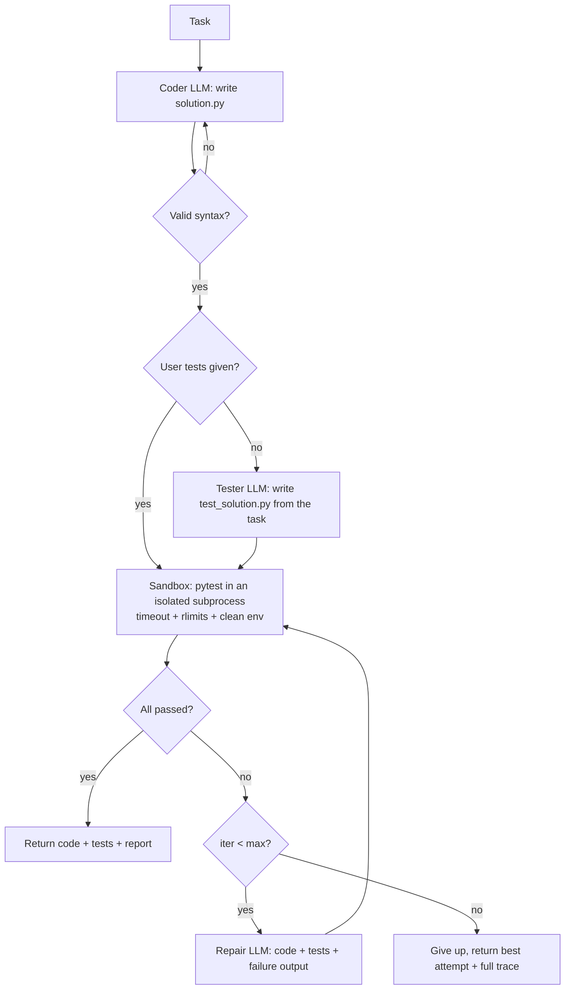

# Self-Testing Code Assistant

A coding agent that doesn't just write code: it **writes the tests too, runs them in a sandbox, and repairs
its own code from the failures** until the tests pass or it reaches an iteration limit.

```
$ python -m assistant "fizzbuzz(n): 'Fizz' for multiples of 3, 'Buzz' for 5, 'FizzBuzz' for both, else str(n)"
[iter 1] FAIL 3 passed, 1 failed
[iter 2] PASS 4 passed, 0 failed
SUCCESS after 2 iteration(s)
```

(That's the built-in offline `mock` provider, which writes a deliberately buggy FizzBuzz first so you can watch the repair loop with no API key.)

## How it works



| Module | Responsibility |
|---|---|
| `assistant/llm.py` | Pluggable providers: OpenAI, Groq, Ollama, Mock, plus `ScriptedLLM` for tests |
| `assistant/prompts.py` | Separate coder / tester / repairer roles |
| `assistant/extract.py` | Pulls code out of fenced replies, checks syntax with `ast`, counts tests |
| `assistant/sandbox.py` | Runs pytest in a temp dir, a separate `python -I` process, minimal env, wall-clock timeout, CPU/memory/file-size rlimits |
| `assistant/agent.py` | The generate → test → run → repair loop with `max_iterations` |
| `assistant/cli.py`, `assistant/api.py` | CLI and optional FastAPI `POST /solve` |

## Quickstart

```bash
python -m venv .venv && source .venv/bin/activate
pip install -r requirements-dev.txt
cp .env.example .env                       # LLM_PROVIDER=mock works offline

python -m assistant --task-file examples/task_slugify.md --out runs/slugify
python -m assistant "parse ISO dates" --tests my_spec.py   # bring your own tests as the spec
python -m assistant "..." --json                           # full per-iteration trace
```

Switching to a real model only takes the `.env`:

```bash
LLM_PROVIDER=groq   LLM_MODEL=llama-3.3-70b-versatile GROQ_API_KEY=...
LLM_PROVIDER=openai LLM_MODEL=gpt-4o-mini            OPENAI_API_KEY=...
LLM_PROVIDER=ollama LLM_MODEL=qwen2.5-coder           # local, free
```

### HTTP API

```bash
uvicorn assistant.api:app --reload
curl -X POST localhost:8000/solve -H 'content-type: application/json' \
     -d '{"task":"Write is_palindrome(s) ignoring case and punctuation","max_iterations":4}'
```

### Docker

```bash
docker build -t self-testing-assistant .
docker run --rm -p 8000:8000 --env-file .env --read-only --tmpfs /tmp --pids-limit 128 self-testing-assistant
```

## Configuration

| Variable | Default | Notes |
|---|---|---|
| `LLM_PROVIDER` | `mock` | `openai` / `groq` / `ollama` / `mock` |
| `LLM_MODEL` | `llama3.1` | |
| `LLM_TEMPERATURE` | `0.2` | |
| `MAX_ITERATIONS` | `4` | run/repair cycles |
| `SANDBOX_TIMEOUT_S` | `20` | wall-clock limit per test run |
| `SANDBOX_MEMORY_MB` | `512` | address-space rlimit (POSIX) |

## Tests

```bash
pytest -q
```

All tests run offline. A `ScriptedLLM` replays fixed replies so every branch of the loop is tested deterministically:
pass on the first try, repair after a failure, give up at the iteration limit, regenerate after a syntax error, and user-supplied tests.
The sandbox tests use real subprocesses to check timeouts on infinite loops, that secrets in the environment aren't passed on, and that import errors or empty suites never count as a pass.

## Design decisions & limitations

- **Tests are written from the task, not the code.** The tester sees only the interface, so it doesn't just copy the code's bugs into its assertions.
- **The tests are the spec during repair.** The repairer may change only the code. If the generated tests themselves are wrong, the loop won't converge. Supplying your own `--tests` avoids that.
- **Sandbox scope.** Subprocess plus rlimits contains accidents like infinite loops, memory blowups and leaked env vars. It isn't a security boundary for hostile code. For that, run it in the Docker image with `--network none`, or swap in gVisor or Firecracker.
- **Cheap checks first.** An `ast` syntax check catches broken output before spending a sandbox run.

## Roadmap

- Let the repairer flag and rewrite a test it believes is wrong (with a separate check)
- Coverage-guided test generation (`pytest-cov` feedback)
- Multi-file projects and dependency installs inside a container sandbox
- Streaming iteration events over SSE
